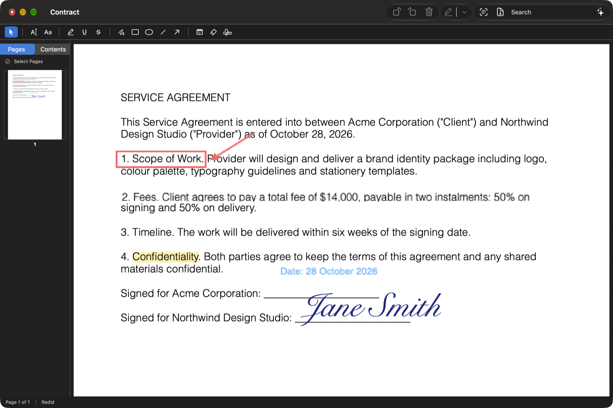
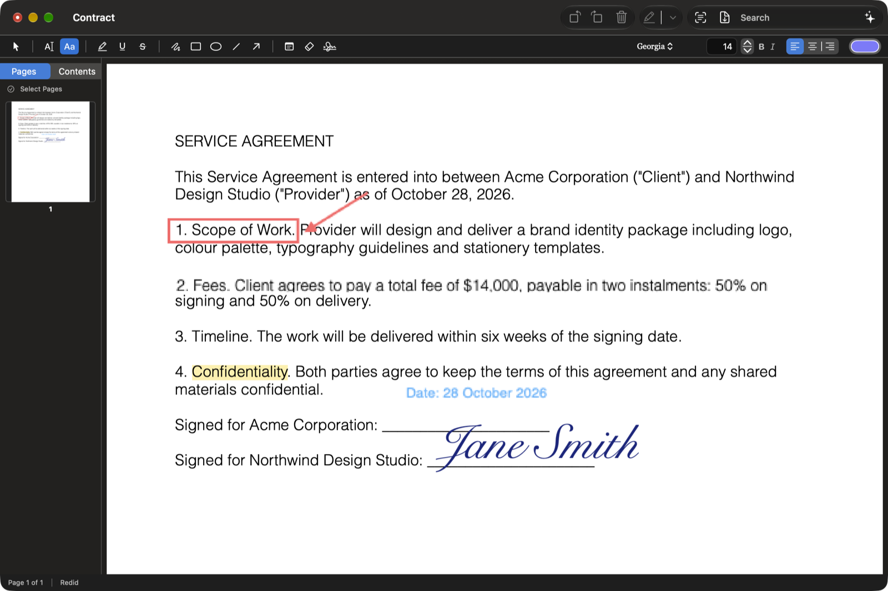

# PDF Engineer

A native macOS PDF editor with the everyday tools you'd reach for in Acrobat: edit text (even on scanned pages after OCR), sign, highlight, draw, add text, reorganize pages, convert Word documents and images to PDF, and export. It also has an on-device AI assistant and a built-in server that lets Claude work on your documents.



- **Everything runs on your Mac.** No account, no upload, and no network needed for editing, OCR or the assistant.
- **Every change can be undone.** Each edit, from a highlight to a deleted page, goes through one undo history, and Edit ▸ Undo names exactly what it will reverse.
- **Your original file is never overwritten silently.** Saves are atomic, conversions write a new file next to the original, and exports go wherever you choose.

---

## Contents

1. [Features](#features)
2. [Installation](#installation)
3. [Walkthrough](#walkthrough)
4. [Keyboard shortcuts](#keyboard-shortcuts)
5. [Command-line tool](#command-line-tool)
6. [Connect Claude (MCP)](#connect-claude-mcp)
7. [On-device assistant](#on-device-assistant)
8. [How editing works, and its limits](#how-editing-works-and-its-limits)
9. [Security and privacy](#security-and-privacy)
10. [Development](#development)
11. [Third-party software](#third-party-software)
12. [License](#license)

---

## Features

| Area | What you can do |
|---|---|
| **Edit** | Retype any line of text, including OCR'd scans · add text boxes with any font, size, colour and alignment · white-out |
| **Mark up** | Highlight, underline, strike through · freehand drawing · rectangles, ovals, lines, arrows · sticky notes |
| **Sign** | Draw, type or import a signature, saved for reuse · place it anywhere, stamped into the page |
| **Pages** | Select many at once · reorder by dragging · rotate · delete · duplicate · insert blank pages or other PDFs · extract · merge |
| **Convert** | Open Word (.docx/.doc), RTF, OpenDocument, text, Markdown, CSV, PNG/JPEG/HEIC/TIFF/GIF/WebP or HTML and get a PDF · combine many files into one PDF |
| **Scans** | OCR turns scanned pages into searchable, selectable text without changing how they look |
| **Export** | Flattened PDF with everything baked in · reduced-size PDF · Markdown or structured JSON for LLMs · print |
| **Navigate** | Search with next/previous and a match counter · zoom and page layouts · table of contents · go to page · recent files |
| **Automate** | `pdfeng` command-line tool · MCP server so Claude can read and edit PDFs · on-device assistant |

---

## Installation

### Download

Get **PDF-Engineer-0.1.0.dmg** from the [Releases page](https://github.com/chase-bratt/pdf-engineer/releases/latest), open it, and drag **PDFEngineer** into **Applications**. It needs macOS 26 or later on Apple silicon.

> The release is ad-hoc signed rather than notarized by Apple, so the first time you open it macOS will say it can't verify the developer. Right-click the app → **Open** → **Open**. If you only get a "Move to Trash" option, open **System Settings ▸ Privacy & Security** and click **Open Anyway**. You only need to do this once.

To check the download, compare its SHA-256 (`shasum -a 256 PDF-Engineer-0.1.0.dmg`) with the one listed on the release.

### Build from source

#### Requirements

- **macOS 26 or later** on Apple silicon. The floor is set by Vision's document recognition, used for OCR.
- **Xcode 26 or later.** The Command Line Tools alone aren't enough: the test frameworks and the Metal compiler for the on-device model ship only with Xcode.
- The **Metal Toolchain** component, needed to compile the AI model's GPU shaders:
  ```sh
  xcodebuild -downloadComponent MetalToolchain
  ```

#### Build and install

```sh
git clone https://github.com/chase-bratt/pdf-engineer.git
cd pdf-engineer
./Scripts/package.sh                       # release build → build/PDFEngineer.app
cp -R build/PDFEngineer.app /Applications/
```

`package.sh` builds the app plus the `pdfeng` and `pdfeng-mcp` helpers into one bundle and signs it. It uses your Apple Development or Developer ID identity if you have one, and an ad-hoc signature otherwise (fine for your own Mac). The scripts locate Xcode themselves, so you don't need `sudo xcode-select`.

> **First launch of an ad-hoc-signed build:** if macOS says the app can't be opened, right-click it → **Open** → **Open**. You only need to do this once.

### Optional: the on-device assistant's model

The assistant uses Qwen3-1.7B (4-bit, about 1 GB), loaded from the Hugging Face cache. Fetch it once:

```sh
python3 -m pip install mlx-lm
python3 -m mlx_lm generate --model mlx-community/Qwen3-1.7B-4bit --prompt hi
```

Everything else works without it. The assistant panel simply tells you the model isn't available.

---

## Walkthrough

### Opening and converting documents

**File ▸ Open (⌘O)**, drag a file onto the window, or use **Open With** in Finder.

- **PDFs** open directly.
- **Word, RTF, OpenDocument, text, Markdown, CSV and images** convert automatically. The PDF is saved next to the original as `name.pdf`, or `name-2.pdf` and so on, never replacing an existing file. Text stays real, selectable text. Images become one page each, sized to the image.
- **HTML pages** convert the same way, offline: remote images, scripts and redirects are blocked.
- **File ▸ Create PDF from Files… (⌥⌘N)** combines any mix of PDFs, documents and images into one PDF, in name order.

### The editing tool bar

The bar under the window toolbar works like Acrobat's. Pick a tool, then work on the page. The settings on the right change with the tool: font controls for text, colour and line width for shapes.

| Tool | Key | How to use it |
|---|---|---|
| Select | V | Click a markup, text box, shape or signature to select it. Drag to move it. ⌫ deletes it. Double-click a text box to edit its words. Changing font or colour restyles the selection. |
| Edit Text | E | Click any line of text and type the replacement. Return applies it, Esc cancels. |
| Add Text | T | Click where the text should go, type, then press Return (⇧↩ for a new line). |
| Highlight / Underline / Strike | | Drag across text; the markup is applied when you let go. ⌃⌘H, ⌃⌘U and ⌃⌘S apply it to an existing selection. |
| Draw | D | Freehand ink. |
| Rectangle / Oval / Line / Arrow | R | Drag to draw. Choose stroke colour, width and an optional fill. |
| Note | N | Click to pin a sticky note and type its text. |
| White-Out | | Drag over something to cover it in the page's own background colour. |
| Sign | | Choose or create a signature, then click to place it at a natural size, or drag to set its size. |

**Font controls:** family, size, bold, italic, alignment and colour. They apply to new text, and to the selected text box when you change them.



### Editing text, including on scans

Choose **Edit Text** and click a line. Its words appear in an editor in the same font and size. Type your change and press Return.

- **On a scanned page:** run **Make Searchable (OCR)** first so the app knows where the words are, then edit as above.
- **Matching the paper:** the replacement is drawn on a cover box coloured to match the page, so it blends into scans as well as white paper.
- **Changing it again:** an edited line stays editable. Click it again with Edit Text, or double-click it with Select.

See [How editing works](#how-editing-works-and-its-limits) for what this means for the underlying file.

### Signing

1. Choose the **Sign** tool, or **Create Signature…** in its settings.
2. Create a signature:
   - **Draw** it with the trackpad or mouse.
   - **Type** your name and pick a handwriting font.
   - **Import** an image of your signature. A white background is made transparent.
3. **Save and Use**. Saved signatures appear in the sheet next time, ready to click.
4. Click on the page to place the signature, or drag a box to size it.

The signature is stamped into the page itself, so it looks the same in every PDF viewer and survives saving and emailing. Undo removes it. Saved signatures are kept in `~/Library/Application Support/PDF Engineer/Signatures`, readable only by your account.

### Working with pages

The sidebar shows page thumbnails. Use the **Pages / Contents** switch above it to show the table of contents instead.

- **Select pages:**
  - Click a page to select it, ⌘-click to add or remove pages, ⇧-click to select a range, and use ↑/↓ to move the selection.
  - **Select Pages** turns on checkboxes, so clicking ticks pages and dragging across thumbnails selects every page you sweep over. **All** and **None** are there too.
- **Reorder:** drag a thumbnail to a new position.
- **Act on the selection:** right-click it, or use the **Pages** menu. You can rotate (⌘[ / ⌘]), delete (⌘⌫), duplicate (⌘D), extract to a new file, or insert a blank page (⇧⌘N) or another PDF (⌥⌘I) after it.
- **Insert from Finder:** drop PDFs onto the sidebar to insert them at that spot.
- **Merge:** **Pages ▸ Merge PDF…** appends a whole document.

### Finding and navigating

- **Search:** ⌘F jumps to the search field. Return or ⌘G goes to the next match, ⇧⌘G to the previous one, and the field shows "3 of 12".
- **Status bar:** shows "Page 7 of 40". Click it, or press ⌥⌘G, to go to a page.
- **View menu:** zoom in, zoom out, actual size and zoom to fit (⌘+ ⌘- ⌘0 ⌘9). You can also switch between Continuous, Single Page and Two Pages.

### OCR: make scans searchable

**Pages ▸ Make Searchable (OCR)**, or the toolbar button, adds an invisible text layer to scanned pages.

- **The scan looks the same,** but you can now search it, select and copy text, edit it, and export it as text.
- **Pages that already have text are skipped.**
- **Your outline, metadata and page boxes are kept.**
- **Unsaved changes:** OCR works from the saved file, so the app asks you to save them first.

### Saving and exporting

| Command | Result |
|---|---|
| **Save (⌘S) / Save As (⇧⌘S)** | Saves your edits. Markup, text boxes and notes stay editable in PDF Engineer, Preview and Acrobat. Writes are atomic, so a failed save never damages the file. |
| **Export as PDF (Flattened)… (⇧⌘E)** | A copy with every edit, signature and markup baked into the pages, so nothing can be moved or removed. Text stays selectable. |
| **Export Reduced Size…** | A smaller copy with recompressed, screen-resolution images, for emailing or upload portals. The status bar reports the size change. |
| **Export as Markdown / JSON** | Clean text for LLMs: headings, paragraphs and tables, in structured `DocAST` JSON or Markdown. |
| **Print… (⌘P)** | Standard macOS printing, scaled to fit. |

- **Unsaved changes:** the window's close button shows the edited dot. Quitting, or opening another file, asks whether to save.

---

## Keyboard shortcuts

| Shortcut | Action |
|---|---|
| ⌘O / ⌥⌘N | Open · Create PDF from files |
| ⌘S / ⇧⌘S | Save · Save As |
| ⇧⌘E / ⌘P | Export flattened PDF · Print |
| ⌘Z / ⇧⌘Z | Undo · Redo (labelled with what they do) |
| ⌘F / ⌘G / ⇧⌘G | Find · next match · previous match |
| ⌘+ / ⌘- / ⌘0 / ⌘9 | Zoom in · out · actual size · fit |
| ⌥⌘G | Go to page |
| ⌥⌘1 / ⌥⌘2 | Page thumbnails · table of contents |
| ⌥⌘A | Select all pages |
| ⌘[ / ⌘] | Rotate left · right |
| ⌘D / ⌘⌫ | Duplicate · delete selected pages |
| ⇧⌘N / ⌥⌘I | Insert blank page · insert pages from file |
| ⌃⌘H / ⌃⌘U / ⌃⌘S | Highlight · underline · strike through the selected text |
| V · E · T · D · R · N | Select · Edit Text · Add Text · Draw · Rectangle · Note (while the page has focus) |
| ⌫ / Esc | Delete the selected markup · back to Select |
| ⌘L | Show or hide the assistant |

---

## Command-line tool

`pdfeng` ships inside the app (`PDFEngineer.app/Contents/MacOS/pdfeng`) and uses the same engine:

```sh
pdfeng info      doc.pdf
pdfeng text      doc.pdf 2-4
pdfeng search    doc.pdf "invoice"
pdfeng convert   out.pdf report.docx photo.heic notes.md     # anything → one PDF
pdfeng html      page.html [out.pdf]
pdfeng merge     out.pdf a.pdf b.pdf
pdfeng extract   in.pdf out.pdf 1-3,7
pdfeng split     in.pdf out-folder --every 5
pdfeng rotate    in.pdf out.pdf 90 1,3-end
pdfeng delete    in.pdf out.pdf 2
pdfeng move      in.pdf out.pdf 1 3
pdfeng ocr       scan.pdf searchable.pdf
pdfeng flatten   in.pdf out.pdf
pdfeng markdown  doc.pdf [out.md]
pdfeng ast       doc.pdf [out.json]
pdfeng ask       doc.pdf "rotate page 2 clockwise"
```

- **Page numbers:** 1-based.
- **Page lists:** ranges such as `1-3,7,10-end` work everywhere.
- **Output file:** must differ from the input, and writes are atomic.

---

## Connect Claude (MCP)

PDF Engineer includes `pdfeng-mcp`, a [Model Context Protocol](https://modelcontextprotocol.io) server, so Claude Desktop or Claude Code can read and edit a PDF. In the app, **Help ▸ Connect Claude…** shows the exact configuration and copies it for you. The app never edits another app's config file itself. To set it up by hand:

```json
{
  "mcpServers": {
    "pdf-engineer": {
      "command": "/Applications/PDFEngineer.app/Contents/MacOS/pdfeng-mcp",
      "args": ["/path/to/your.pdf"]
    }
  }
}
```

**Tools:** `get_document_info`, `get_page_text`, `search_document`, `export_markdown`, `rotate_pages`, `delete_pages`, `move_page`, `extract_pages`, `undo`, `redo`, `save_document`, `get_history`.

**Safeguards:**
- **Explicit confirmation:** deleting pages and saving over the file need an explicit `"confirm": true`.
- **Undo:** every edit can be undone with `undo` until it's saved.
- **New files only:** `extract_pages` writes a new file next to the document and never overwrites one.
- **Document text is treated as data:** it's returned escaped inside a delimiter, so text in a PDF can't pose as instructions to the model.

---

## On-device assistant

Click **✨ Assistant** in the toolbar, or press ⌘L, and ask in plain English:

```
find every mention of invoice        how many times does Acme appear
replace every Acme with Globex       rotate page 2 clockwise
delete pages 3 and 5                 make this searchable
```

- **Local only:** it runs Qwen3-1.7B on your Mac through MLX. No network, no account.
- **Parses, never touches:** the model only turns your request into a structured command, and the app's tested code carries it out. The model never sees or touches the document's bytes, so it can't corrupt a PDF.
- **Confirms destructive edits:** delete and replace are described first and only run when you click **Do it**. Each confirmation works once, and only on the document as it was when you asked.
- **Measured performance:** about 0.8 s to load and about 3 s per reply, with roughly 1 GB peak memory. The model loads on first use and unloads when the panel closes.

---

## How editing works, and its limits

PDF is a page-layout format, not a word-processing one. A page's text is a list of positioned glyphs, often drawn with a font cut down to the characters used. PDF Engineer edits honestly within that:

- **Edit Text covers and replaces.**
  - The original line is covered by a box in the page's background colour, and your text is drawn on top as a text annotation. It looks like the edit was made in place, and it stays editable.
  - **The original words remain in the file underneath.** That makes this an edit, not redaction. Don't use it to hide confidential information. To remove sensitive content permanently, use Export as PDF (Flattened) and then OCR the result, or a dedicated redaction tool.
  - Paragraphs don't reflow. A longer replacement extends the line rather than wrapping.
- **Signatures and flattened exports are baked into the page.** Annotations, highlights, text boxes and shapes stay as standard PDF annotations that other apps can edit, until you flatten.
- **Document conversion:**
  - **Kept:** fonts, colours, paragraphs, lists and inline images.
  - **Not kept:** headers and footers, footnotes, floating shapes and text boxes, tracked changes, and complex table layouts. Markdown converts as plain text.
- **OCR:** quality depends on the scan. OCR text is invisible but selectable, and Edit Text sizes your replacement to the line.

---

## Security and privacy

- **Nothing leaves your Mac.** The app makes no network requests while editing, converting, running OCR or using the assistant. HTML conversion runs offline with a non-persistent web data store, and remote resources and navigations are blocked.
- **No silent overwrites.** Saves are atomic (temporary file, then replace). Conversions and extracts create new files and never follow symbolic links over existing ones. The CLI refuses to write over its own input.
- **Bounded inputs.** Oversized images, huge page lists and runaway conversions are refused with clear errors instead of exhausting memory.
- **Private data stays private.** Signatures are stored with owner-only permissions (0700 folder, 0600 files).
- **Signing and sandbox.** The app is signed with the hardened runtime and has no JIT, network or library-validation exceptions. It is **not sandboxed** yet, so it reads and writes files with your normal user permissions, like most document editors that aren't from the App Store.

Found a vulnerability? Please open a private security advisory on GitHub rather than a public issue.

---

## Development

```sh
./Scripts/build.sh                      # debug build
./Scripts/test.sh                       # all tests (swift-testing)
./Scripts/test.sh --filter PageRange    # one suite
./Scripts/package.sh --debug            # debug .app bundle
```

```
Sources/
  PDFCore/         page grafting, page ranges, conversion (documents, images, HTML), flattening, atomic writes
  DocumentModel/   undoable Commands: pages, annotations, markup, signatures, insertion
  OCR/             Vision pipeline that adds an invisible, positioned text layer
  Export/          DocAST → Markdown / JSON
  MCPServer/       MCP tool catalogue over DocumentModel commands
  Assistant/       on-device model → intent → tested command
  PDFEngineerApp/  SwiftUI + AppKit app: canvas and tools, sidebar, tool bar, signatures
  pdfeng/          command-line tool
  pdfeng-mcp/      stdio MCP server
Tests/             swift-testing suites for every module
contracts/         docast.schema.json
```

**Design rules:**
- **One path for changes:** every change to a document is a `Command` with an exact inverse, applied through one `CommandStack`. Menus, tools, the assistant and the MCP server all use it, so undo and the history log see everything.
- **PDFKit stays on one thread:** it has no concurrency annotations, so each document is confined to the main actor, and background work receives extracted values, never a live `PDFDocument`.
- **Modules depend downward only:** PDFCore depends on nothing, and a dependency cycle is a build error.

---

## Third-party software

| Package | License |
|---|---|
| [MLX Swift LM](https://github.com/ml-explore/mlx-swift-lm) and [MLX Swift](https://github.com/ml-explore/mlx-swift) | MIT |
| [swift-transformers](https://github.com/huggingface/swift-transformers) | Apache-2.0 |
| [MCP Swift SDK](https://github.com/modelcontextprotocol/swift-sdk) | MIT |
| [Qwen3-1.7B](https://huggingface.co/Qwen/Qwen3-1.7B) model weights (downloaded separately) | Apache-2.0 |

## License

Released under the [MIT License](LICENSE).
